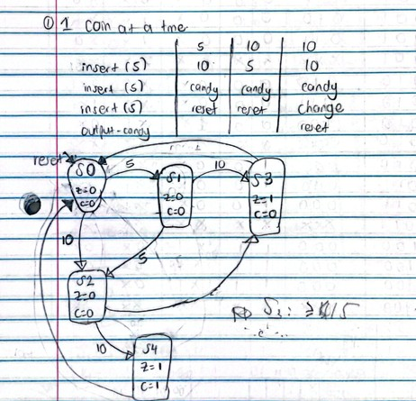
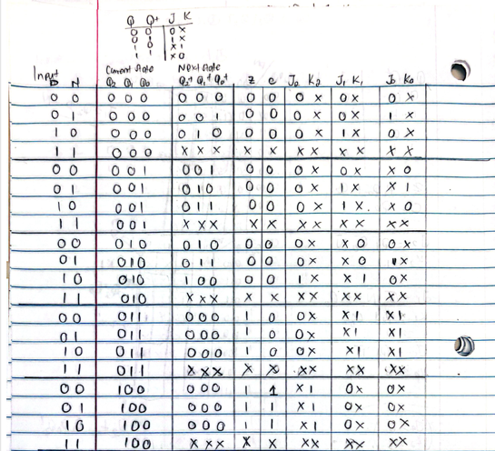
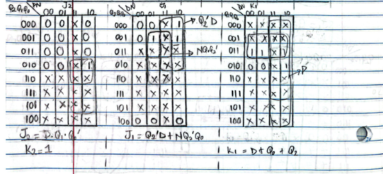
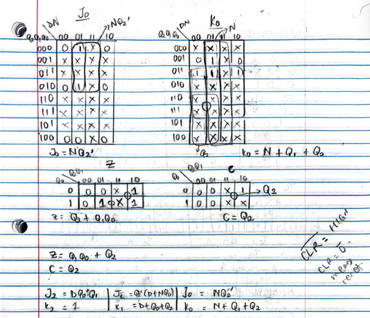
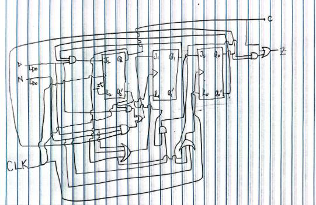
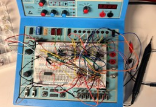
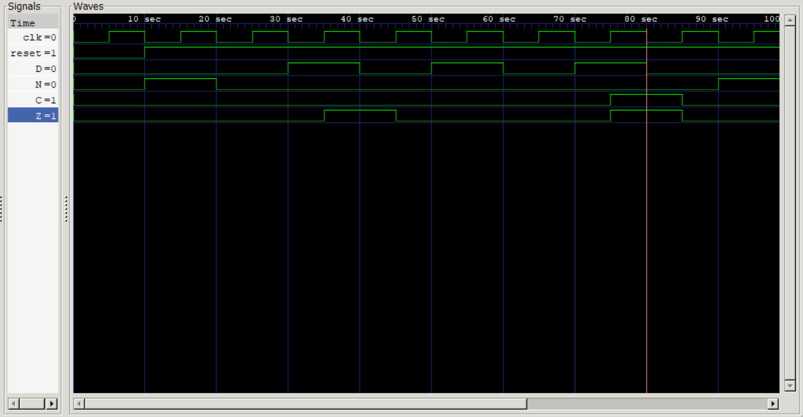

# SystemVerilog Vending Machine FSM

A five-state **Moore finite state machine** for a 15-cent vending machine, implemented in SystemVerilog and verified using **Icarus Verilog** and **GTKWave**.

This project began as a physical digital-logic design built with **J-K flip-flops and TTL logic gates**. After validating the hardware implementation, I recreated the controller in synthesizable SystemVerilog and developed a testbench to verify its behavior in simulation.

The project demonstrates the complete progression from:

**FSM design → state encoding → excitation tables → Karnaugh maps → TTL hardware → RTL implementation → simulation and verification**

---

## Project Overview

The vending machine accepts two types of coins:

- `N` — Nickel, worth 5 cents
- `D` — Dime, worth 10 cents

The cost of the candy is **15 cents**.

The controller produces two outputs:

- `Z` — Candy dispense signal
- `C` — Change signal

The machine:

- accumulates inserted coin values,
- dispenses candy when 15 cents is reached,
- dispenses candy and returns 5 cents of change when 20 cents is reached,
- automatically returns to the initial state after dispensing.

Only one coin input is expected to be asserted at a time.

---

## Design Architecture

The controller is implemented as a **Moore FSM**, meaning the outputs depend only on the current state.

Five states are represented using a 3-bit state register:

| State | Encoding | Meaning | `Z` | `C` |
|---|---:|---|:---:|:---:|
| `S0` | `000` | 0 cents / initial state | 0 | 0 |
| `S1` | `001` | 5 cents accumulated | 0 | 0 |
| `S2` | `010` | 10 cents accumulated | 0 | 0 |
| `S3` | `011` | 15 cents — dispense candy | 1 | 0 |
| `S4` | `100` | 20 cents — candy + change | 1 | 1 |

After entering `S3` or `S4`, the controller returns to `S0` on the following clock cycle.

---

## State Transitions

```text
                 Nickel
          +------------------+
          |                  v
        +----+              +----+
        | S0 | -- Nickel -->| S1 |
        | 0¢ |              | 5¢ |
        +----+              +----+
          |                   |
        Dime                Nickel
          |                   |
          v                   v
        +----+              +----+
        | S2 |<-------------+
        |10¢ |
        +----+
         |  |
 Nickel  |  | Dime
         |  |
         v  v
      +----+   +----+
      | S3 |   | S4 |
      |Vend|   |Vend|
      |    |   |+Chg|
      +----+   +----+
         |       |
         +---+---+
             |
             v
            S0
```

More directly:

```text
S0 + Nickel -> S1
S0 + Dime   -> S2

S1 + Nickel -> S2
S1 + Dime   -> S3

S2 + Nickel -> S3
S2 + Dime   -> S4

S3 -> S0
S4 -> S0
```

### Original State-Transition Diagram



---

## Original Hardware Design

The first version of this project was implemented using discrete TTL logic.

The design process included:

1. defining the FSM states,
2. assigning binary state encodings,
3. constructing the state-transition table,
4. deriving J-K flip-flop excitation values,
5. simplifying the logic using Karnaugh maps,
6. implementing the resulting equations using TTL gates and J-K flip-flops,
7. testing the finished circuit on a breadboard.

Three flip-flops were required to encode the five states.

### State Transition / Excitation Table



### Karnaugh Map Simplification





### Gate-Level Circuit



---

## Physical Implementation

The FSM was physically implemented using J-K flip-flops and TTL combinational logic.

Coin inputs were applied through switches, while LEDs were used to observe state and output behavior.



One of the main challenges during the physical implementation was incorrect use of don't-care conditions during Karnaugh-map simplification. Early versions produced unintended flip-flop toggling and unstable state transitions.

The design was corrected by returning to the excitation table, re-evaluating the required transitions, and simplifying the logic without allowing invalid states to alter intended behavior.

That debugging process reinforced an important digital-design principle:

> **Logic minimization is only useful if functional correctness is preserved.**

---

## SystemVerilog RTL Implementation

The hardware controller was later recreated as a synthesizable SystemVerilog FSM.

The RTL is divided into three main sections:

### 1. State Register

The current state is stored in a 3-bit register and updated on the rising edge of the clock.

The design uses an **active-low asynchronous reset** to force the FSM back to `S0`.

```systemverilog
always_ff @(posedge clk or negedge reset) begin
    if (!reset)
        state <= S0;
    else
        state <= next_state;
end
```

### 2. Next-State Logic

Combinational logic determines the next state from the current state and coin inputs.

Example:

```systemverilog
S1: begin
    if (N)
        next_state = S2;
    else if (D)
        next_state = S3;
    else
        next_state = S1;
end
```

### 3. Moore Output Logic

Because this is a Moore machine, `Z` and `C` depend only on the current state.

```systemverilog
if (state == S3)
    Z = 1;

else if (state == S4) begin
    Z = 1;
    C = 1;
end
```

The complete RTL is available in:

[`vendingMachine.sv`](vendingMachine.sv)

---

## Verification

A SystemVerilog testbench applies several valid coin sequences and checks the resulting outputs.

The current testbench verifies three important cases:

### Test 1 — Nickel + Dime

```text
0¢ -> 5¢ -> 15¢
```

Expected result:

```text
Z = 1
C = 0
```

Candy is dispensed with no change.

### Test 2 — Dime + Dime

```text
0¢ -> 10¢ -> 20¢
```

Expected result:

```text
Z = 1
C = 1
```

Candy is dispensed and 5 cents of change is returned.

### Test 3 — Three Nickels

```text
0¢ -> 5¢ -> 10¢ -> 15¢
```

Expected result:

```text
Z = 1
C = 0
```

Candy is dispensed with no change.

The complete testbench is available in:

[`vendingMachine_tb.sv`](vendingMachine_tb.sv)

---

## Simulation Waveform

The RTL was compiled with **Icarus Verilog** and analyzed using **GTKWave**.



The waveform demonstrates correct vending behavior, including:

- nickel and dime input pulses,
- candy assertion at 15 cents,
- candy and change assertion at 20 cents,
- automatic return to the initial state after vending.

---

## Running the Project

### Requirements

Install:

- Icarus Verilog
- GTKWave
- GNU Make

### Compile and Simulate

```bash
make
```

This runs:

```bash
iverilog -g2012 -s vending_machine_tb \
-o vendingMachine_sim \
vendingMachine.sv vendingMachine_tb.sv

vvp vendingMachine_sim
```

### View the Waveform

```bash
make wave
```

### Clean Generated Files

```bash
make clean
```

---

## Repository Structure

```text
systemverilog-vendingmachine-fsm/
│
├── vendingMachine.sv
├── vendingMachine_tb.sv
├── Makefile
├── README.md
├── LICENSE
├── Vending Machine KPA.docx
│
└── images/
    ├── circuitDiagram.png
    ├── kmap1.png
    ├── kmap2.png
    ├── stateTransitionDiagram.jpg
    ├── stateTransitionTable.png
    ├── vendingMachineBreadboard.jpg
    └── vendingMachineWaveform.png
```

---

## Tools and Technologies

**RTL / Verification**

- SystemVerilog
- Icarus Verilog
- GTKWave
- GNU Make

**Digital Hardware**

- Moore finite state machines
- J-K flip-flops
- Karnaugh maps
- TTL combinational logic
- Breadboard prototyping
- Clocked sequential logic

---

## What I Learned

This project strengthened my understanding of how the same digital system can be represented at multiple abstraction levels.

### Logic-Level Design

I gained experience with:

- state encoding,
- state-transition tables,
- J-K excitation tables,
- Karnaugh-map simplification,
- synchronous sequential circuits.

### Hardware Debugging

The physical implementation showed how seemingly small errors in Boolean simplification can produce real hardware failures such as unintended toggling and unstable state transitions.

### RTL Design

Reimplementing the controller in SystemVerilog showed how the same hardware behavior can be expressed more clearly using:

- state registers,
- combinational next-state logic,
- Moore output logic.

### Verification

Simulation with Icarus Verilog and GTKWave provided a way to observe and verify the FSM before or independently of physical implementation.

---

## Design Progression

One of the main reasons I included this project in my hardware portfolio is the progression across abstraction levels:

```text
Problem Specification
        ↓
State Diagram
        ↓
State Transition Table
        ↓
J-K Excitation Table
        ↓
Karnaugh Maps
        ↓
TTL Gate-Level Implementation
        ↓
Physical Breadboard Verification
        ↓
SystemVerilog RTL
        ↓
Testbench
        ↓
GTKWave Simulation
```

This progression demonstrates the connection between fundamental digital logic and modern RTL-based hardware design.

---

## Project Background

The original physical vending-machine controller was developed as a **Digital Systems Design course project at Oral Roberts University**.

The original hardware work was completed collaboratively as a team project. The SystemVerilog implementation and simulation were subsequently developed to extend the design into an RTL-based hardware workflow.

---

## License

This project is licensed under the terms provided in the repository's [`LICENSE`](LICENSE) file.
